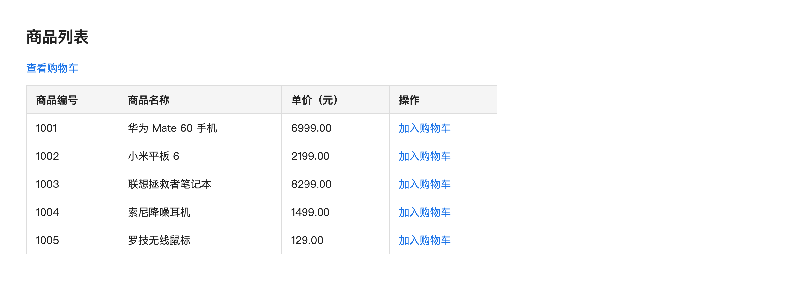
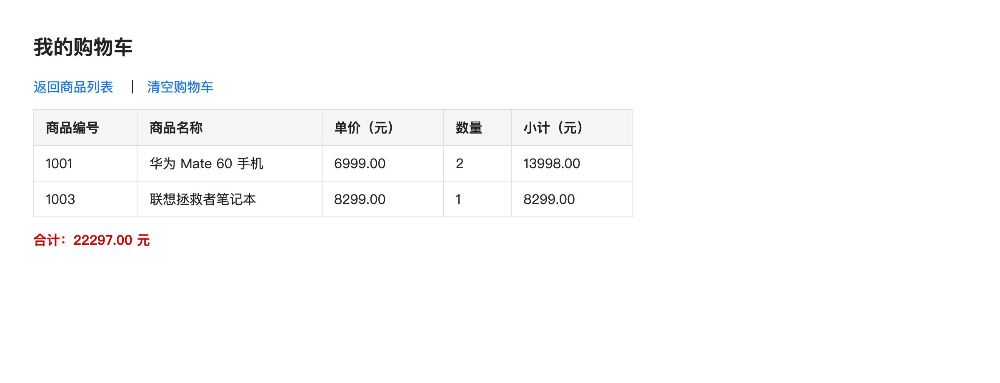
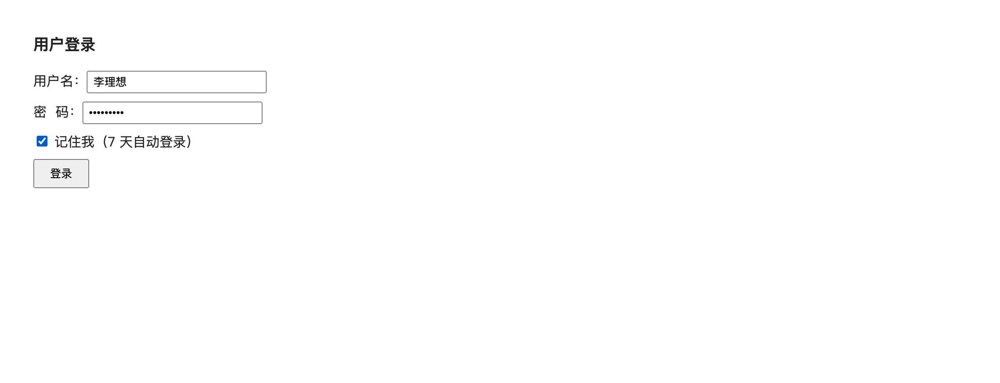
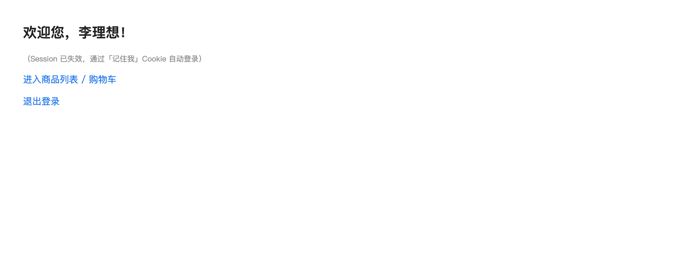
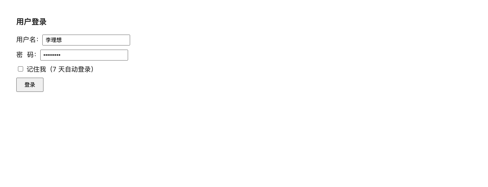

# 实验四 会话技术

学号：092224110　姓名：李理想

## 一、实验目的

1. 了解 HTTP 协议的无状态特性和会话的概念；
2. 掌握如何使用 HttpSession 对象实现会话管理；
3. 学会 Cookie 及其应用；
4. 掌握 Session 与 Cookie 的区别及应用场景。

## 二、实验内容

1. 基于 Cookie 实现电商网站未登录状态购物车：

   （1）使用 Cookie 保存未登录用户的购物车数据，Cookie 有效期设置 7 天。

   （2）页面包括：商品列表页、购物车页面。

   （3）编码处理：Cookie 只能保存字符串，多个商品用分隔符拼接存储。（Cookie 不能直接保存中文，建议商品编号，页面展示商品名称）。

   （4）程序健壮性：添加重复商品时，商品数量累加，新商品则新增一条记录。

   （5）写出具体步骤、关键代码，并给出运行截图。（截图时请写自己的真实姓名）

2. 基于 Cookie+Session 协同实现网站“记住我”自动登录功能

   （1）页面包含：登录页面 login.html、主页 IndexServlet、登录处理 LoginServlet、退出登录 LogoutServlet。

   （2）使用“Cookie + Session”协同完成记住我自动登录；Session 保存当前会话登录状态，Cookie 持久保存用户名。

   （3）预设测试账号：用户名自己的姓名，密码自己的学号。

   （4）页面跳转使用重定向。

   （5）业务规则：

   - ☆勾选【记住我（7 天自动登录）】：登录成功，创建有效期 7 天的 Cookie 存储用户名，同时创建 Session 保存登录用户。
   - ☆不勾选【记住我】：仅创建 Session，删除旧的记住我 Cookie；浏览器关闭后登录状态失效。
   - ☆访问主页时，先判断 Session 是否存在登录用户；Session 失效时，读取 Cookie，存在用户名则自动重建 Session，完成自动登录。
   - ☆退出登录：销毁当前 Session，同时删除浏览器中的记住我 Cookie，跳转回登录页面。

   （6）写出具体步骤、关键代码，并给出运行截图。（截图时用户名请写自己的真实姓名）

3. 将实验代码（自己创建的 Web 应用目录）进行压缩并命名为自己的学号和姓名（如 092214101 张三），与本实验报告（完成后的文档，不压缩）、运行截图（不压缩）一起，在蓝墨云中以附件的形式（2 个附件）进行提交到实验 4 中。

## 三、实验过程

本实验在项目 java-web-labs 中新建 Maven 模块 labs/lab04（war 打包），Java 源码包名为 com.hmi.lab04，并在父工程 pom.xml 的 `<modules>` 中完成注册。模块中新增的主要文件如下：

| 文件 | 说明 |
| --- | --- |
| `Goods.java`、`GoodsRepository.java` | 商品实体与商品数据源（用静态集合模拟数据库） |
| `CartUtil.java` | 购物车 Cookie 的编解码工具类 |
| `GoodsListServlet.java`（`/goods`） | 商品列表页 |
| `CartServlet.java`（`/cart`） | 购物车页（加入、查看、清空） |
| `login.html` | 登录页面（含“记住我”复选框） |
| `LoginServlet.java`（`/login`） | 登录处理 |
| `IndexServlet.java`（`/index`） | 主页（含自动登录判断） |
| `LogoutServlet.java`（`/logout`） | 退出登录 |

### （一）基于 Cookie 的未登录状态购物车

#### 1. 设计思路

- Cookie 保存在客户端，只能存储字符串，而且不能直接保存中文。因此购物车 Cookie 只保存“商品编号”和“数量”，用分隔符拼接成 `编号:数量,编号:数量` 的形式（例如 `1001:2,1003:1`），写入前整体做一次 URL 编码，读取时再解码；页面展示时用商品编号反查商品名称。
- Cookie 名为 `cart`，通过 `setMaxAge(7*24*60*60)` 设置 7 天有效期，`setPath(上下文路径)` 设置作用路径，保证整个应用都能读写。
- 程序健壮性：加入购物车时使用 `Map.merge(id, 1, Integer::sum)`，重复商品数量自动累加，新商品自动新增一条记录。

#### 2. 具体实现步骤

1. 在父工程 pom.xml 的 `<modules>` 中注册 `labs/lab04`，新建 Maven war 模块并建立标准目录结构。
2. 编写商品实体 `Goods` 和商品数据源 `GoodsRepository`（用静态 `LinkedHashMap` 模拟数据库，共 5 件商品）。
3. 编写工具类 `CartUtil`，负责购物车字符串与 `Map` 之间的序列化与反序列化。
4. 编写商品列表页 `GoodsListServlet`（`/goods`），输出商品表格，每行提供“加入购物车”链接并携带商品编号。
5. 编写 `CartServlet`（`/cart`）：`action=add` 时读取 Cookie、累加数量、写回 Cookie，然后重定向到 `action=view`；`action=view` 输出购物车页面；`action=clear` 清空购物车。
6. 部署运行，验证“重复商品数量累加、新商品新增记录”。

#### 3. 关键代码

（1）`CartUtil`：购物车 Cookie 的解析与序列化（商品编号与数量用冒号、逗号拼接，并做 URL 编码）

```java
public static Map<String, Integer> parse(String cookieValue) {
    Map<String, Integer> cart = new LinkedHashMap<>();
    if (cookieValue == null || cookieValue.isEmpty()) return cart;
    String decoded = URLDecoder.decode(cookieValue, StandardCharsets.UTF_8);
    for (String pair : decoded.split(",")) {
        String[] kv = pair.split(":");
        if (kv.length == 2) cart.put(kv[0], Integer.parseInt(kv[1]));
    }
    return cart;
}

public static String serialize(Map<String, Integer> cart) {
    StringBuilder sb = new StringBuilder();
    for (Map.Entry<String, Integer> entry : cart.entrySet()) {
        if (sb.length() > 0) sb.append(',');
        sb.append(entry.getKey()).append(':').append(entry.getValue());
    }
    return URLEncoder.encode(sb.toString(), StandardCharsets.UTF_8);
}
```

（2）`CartServlet`：加入购物车并写回 Cookie（有效期 7 天，重复商品数量累加）

```java
private void addToCart(HttpServletRequest request, HttpServletResponse response) {
    String id = request.getParameter("id");
    if (GoodsRepository.findById(id) == null) return;
    Map<String, Integer> cart = readCart(request);
    cart.merge(id, 1, Integer::sum);              // 重复商品数量累加，新商品新增记录
    Cookie cookie = new Cookie(CartUtil.CART_COOKIE, CartUtil.serialize(cart));
    cookie.setMaxAge(CartUtil.CART_MAX_AGE);      // 有效期 7 天
    cookie.setPath(request.getContextPath().isEmpty() ? "/" : request.getContextPath());
    response.addCookie(cookie);
}
```

#### 4. 运行截图



图 1　商品列表页（GoodsListServlet）



图 2　购物车页面（商品 1001 加入两次、1003 加入一次，数量正确累加，合计 22297.00 元）

### （二）基于 Cookie + Session 的“记住我”自动登录

#### 1. 设计思路

- Session 保存在服务端，用于保存当前会话的登录状态（`loginUser`）；Cookie 保存在客户端，用于持久保存用户名（`rememberMe`）。二者协同完成“记住我”自动登录。
- 勾选“记住我”：登录成功时创建有效期 7 天的 Cookie 持久保存用户名，同时创建 Session 保存登录用户。
- 不勾选“记住我”：只创建 Session，并删除旧的“记住我”Cookie，浏览器关闭后登录状态失效。
- 访问主页时先判断 Session 中是否存在登录用户；Session 失效时读取 Cookie，存在用户名则重建 Session，完成自动登录。
- 退出登录：销毁当前 Session，同时删除浏览器中的“记住我”Cookie，重定向回登录页面。
- 所有页面跳转统一使用重定向（`sendRedirect`）。

#### 2. 具体实现步骤

1. 编写 `login.html`：包含用户名、密码输入框和“记住我”复选框，表单以 POST 方式提交到 `/login`。
2. 编写 `LoginServlet`（`/login`）：校验预设账号（用户名＝本人姓名，密码＝本人学号），按是否勾选“记住我”分别处理 Session 与 Cookie，最后重定向到 `/index`。
3. 编写 `IndexServlet`（`/index`）：先判断 Session，失效则读取“记住我”Cookie 并重建 Session 完成自动登录，两者都没有则重定向到登录页。
4. 编写 `LogoutServlet`（`/logout`）：`invalidate()` 销毁 Session，把“记住我”Cookie 的 `maxAge` 设为 0 将其删除，重定向回登录页。
5. 部署运行，验证“勾选记住我”“不勾选记住我”“Session 失效后自动登录”“退出登录”四种场景。

#### 3. 关键代码

（1）`LoginServlet`：Session 与“记住我”Cookie 的协同处理

```java
if (PRESET_USERNAME.equals(username) && PRESET_PASSWORD.equals(password)) {
    HttpSession session = request.getSession();
    session.setAttribute("loginUser", username);      // Session 保存登录状态
    if ("true".equals(rememberMe)) {
        Cookie cookie = new Cookie(REMEMBER_COOKIE,
                URLEncoder.encode(username, StandardCharsets.UTF_8));
        cookie.setMaxAge(REMEMBER_MAX_AGE);           // 7 天
        cookie.setPath(cookiePath);
        response.addCookie(cookie);
    } else {
        Cookie cookie = new Cookie(REMEMBER_COOKIE, "");
        cookie.setMaxAge(0);                          // 删除旧的记住我 Cookie
        cookie.setPath(cookiePath);
        response.addCookie(cookie);
    }
    response.sendRedirect(ctx + "/index");            // 重定向
} else {
    response.sendRedirect(ctx + "/login.html?error=1");
}
```

（2）`IndexServlet`：Session 失效时读取 Cookie 重建 Session 完成自动登录

```java
HttpSession session = request.getSession(false);
String loginUser = (session != null) ? (String) session.getAttribute("loginUser") : null;
if (loginUser == null) {                              // Session 失效，读取记住我 Cookie
    Cookie[] cookies = request.getCookies();
    if (cookies != null) {
        for (Cookie cookie : cookies) {
            if (LoginServlet.REMEMBER_COOKIE.equals(cookie.getName())
                    && cookie.getValue() != null && !cookie.getValue().isEmpty()) {
                loginUser = URLDecoder.decode(cookie.getValue(), StandardCharsets.UTF_8);
                request.getSession().setAttribute("loginUser", loginUser);  // 重建 Session
                break;
            }
        }
    }
}
if (loginUser == null) {
    response.sendRedirect(ctx + "/login.html");
    return;
}
```

#### 4. 运行截图



图 3　登录页面（已勾选“记住我（7 天自动登录）”，用户名为本人姓名）


图 4　登录成功后的主页 IndexServlet



图 5　模拟 Session 失效（只保留持久 Cookie）后访问主页，自动登录成功



图 6　退出登录后销毁 Session 并删除 Cookie，重定向回登录页面

## 四、思考与小结

### 1. Session 和 Cookie 分别保存在客户端还是服务端？在案例中各自承担什么作用？

答：Cookie 保存在客户端（浏览器），Session 保存在服务端。在本案例中，Cookie 承担两件事：一是购物车（`cart`）在客户端持久保存未登录用户的购物车数据，二是“记住我”（`rememberMe`）持久保存用户名；Session 承担登录状态（`loginUser`），在服务端保存当前会话的登录用户，主页据此判断用户是否已登录。需要说明的是，Session 的会话标识 `JSESSIONID` 本身也是通过 Cookie 在客户端与服务端之间传递的。

### 2. 购物车为什么未登录场景选用 Cookie？Cookie 优缺点是什么？

答：未登录用户没有会话主体，服务端无法用 Session 把购物车归属到某个具体用户，一旦关闭浏览器或更换浏览器购物车就会丢失，因此把购物车放在客户端 Cookie 中保存，7 天内再次访问仍能恢复。

Cookie 的优点：保存在客户端，不占用服务器资源；可通过 `maxAge` 在客户端持久保存，关闭浏览器、会话失效后依然有效；实现简单，无需登录即可使用。

缺点：容量很小（单个一般约 4KB，同一站点的数量也有限制）；只能保存字符串，中文和对象需要编码或序列化；数据保存在客户端，可被用户查看和篡改，不适合保存敏感信息；会随每次请求发送，增加网络流量；用户可以禁用或清除 Cookie。

### 3. Cookie 存储数据有哪些限制？能不能直接存储对象、中文？

答：限制主要有：①容量小，单个 Cookie 一般不超过 4KB，同一站点下 Cookie 的数量和总容量也有限制；②只能保存字符串文本，不能直接保存对象；③不能直接保存中文等非 ASCII 字符；④保存在客户端，安全性差、容易被篡改；⑤会随每次请求发送，数量过多会影响性能。

因此不能直接存储对象，需要先序列化（如转成 JSON 字符串）再存入；也不能直接存储中文，需要先做 URL 编码（`URLEncoder`）或用 Base64 编码，读取时再解码。本实验正是把购物车拆成“编号:数量”字符串并做 URL 编码后再写入 Cookie 的。

### 4. “记住我”功能为什么 Cookie 里面只存储用户名，不存储密码？

答：出于安全考虑。Cookie 保存在客户端，用户可以直接查看，传输过程中也可能被窃取；一旦把密码写入 Cookie，等于把账号密码明文暴露在客户端，风险极高。而只保存用户名，即使被看到或篡改，攻击者也无法仅凭它通过登录校验，服务端仍会把它当作“待验证的用户标识”，必要时还可以要求重新输入密码。所以“记住我”只保存用户名（或服务端下发的令牌），用最小必要信息完成自动登录。

### 5. 如果清除浏览器 Cookie，勾选记住我的自动登录还能生效吗？为什么？

答：不能生效。“记住我”的自动登录依赖客户端持久 Cookie（`rememberMe`）中保存的用户名；清除浏览器 Cookie 会把这个 Cookie 一并删除，服务端既拿不到 Cookie，会话 Cookie（`JSESSIONID`）也已经失效，无法识别用户，只能重定向回登录页面要求重新登录。要恢复自动登录，必须重新登录并再次勾选“记住我”。

### 6. 简述 Session 与 Cookie 的区别及各自的应用场景。

答：区别主要有：①存储位置不同，Cookie 保存在客户端浏览器，Session 保存在服务端；②安全性不同，Cookie 在客户端可被查看和篡改，Session 数据保存在服务端相对安全；③存储容量不同，Cookie 单个约 4KB 且数量有限，Session 受服务器内存限制、容量大得多；④数据类型不同，Cookie 只能存字符串，Session 可以存任意 Java 对象；⑤生命周期不同，Cookie 可通过 `maxAge` 长期保存在客户端，Session 默认随会话结束（关闭浏览器或超时）而失效；⑥两者有联系，Session 依赖 `JSESSIONID` 这个 Cookie 来标识会话。

应用场景：Cookie 适合保存不敏感、需要长期留在客户端的轻量数据，如“记住我”的用户名、购物车、用户偏好、浏览记录等；Session 适合保存与用户会话相关的敏感或复杂数据，如登录状态、权限信息、验证码、订单流程数据等。实际开发中二者常常协同使用，本实验的“记住我”正是 Cookie + Session 协同的典型应用。

### 7. 说明实验过程中出现的问题以及解决问题的方法步骤

（1）问题：把商品名称直接写入 Cookie 后出现乱码甚至写入失败。

原因与解决：Cookie 的值只能是字符串，且不能直接保存中文，中文必须先做编码处理。改为在 Cookie 中只保存商品编号和数量（如 `1001:2,1003:1`），并用 `URLEncoder` / `URLDecoder` 做整体编解码，页面展示时再用编号反查商品名称，问题解决。

（2）问题：加入购物车后刷新页面，商品被重复添加。

原因与解决：加入购物车后直接输出页面，浏览器刷新会重复提交上一次请求。改为 add 操作处理完后用 `response.sendRedirect(ctx + "/cart?action=view")` 重定向到购物车页，刷新时只重复一个 GET 请求，不再重复添加。

（3）问题：重定向后出现 404 错误。

原因与解决：应用部署在 `/lab04` 上下文下，而最初写的 `sendRedirect("/index")` 是相对服务器根路径的。改为统一使用 `request.getContextPath()` 拼接路径，如 `sendRedirect(ctx + "/index")`，问题解决。

（4）问题：退出登录后“记住我”Cookie 仍然存在，再次访问主页依然能自动登录。

原因与解决：删除 Cookie 时没有设置与创建时相同的 `path`，导致删除无效。改为删除时同样 `setPath(上下文路径)` 并 `setMaxAge(0)`，让浏览器立即失效该 Cookie，问题解决。

（5）问题：关闭浏览器后无法自动登录。

原因与解决：最初把用户名只放在 Session 中，浏览器关闭后 Session 失效便无从恢复。改为在 `IndexServlet` 中先判断 Session，失效时读取“记住我”Cookie 并重建 Session，从而完成自动登录，问题解决。

### 小结

通过本次实验，我理解了 HTTP 协议“无状态”的含义，也理解了会话技术解决这一问题的两种思路：Cookie 把状态保存在客户端，Session 把状态保存在服务端。

在实验内容一中，我用 Cookie 实现了未登录状态的购物车，掌握了 Cookie 的创建、读取、修改和删除（`setMaxAge(0)`），也体会到 Cookie 只能保存字符串这一限制——因此把购物车编码成“编号:数量”字符串并做 URL 编码，展示时再用编号反查商品名称；并通过 `Map.merge` 实现了重复商品数量累加、新商品新增记录。

在实验内容二中，我用 Session + Cookie 协同实现了“记住我”自动登录，理清了二者的分工：Session 保存当前会话的登录状态，Cookie 持久保存用户名；同时完成了勾选与不勾选“记住我”、Session 失效后自动登录、退出登录等业务规则，页面跳转统一使用重定向。

本次实验最大的收获是弄清了 Cookie 与 Session 各自的特点和适用场景：Cookie 适合保存客户端不敏感的轻量数据，Session 适合保存服务端的敏感会话数据，实际开发中二者常常协同使用。此外，在调试过程中还踩到了中文编码、重定向路径、Cookie 删除路径等“坑”，使我对 Cookie 的作用路径、有效期和编码方式有了更具体的认识。
